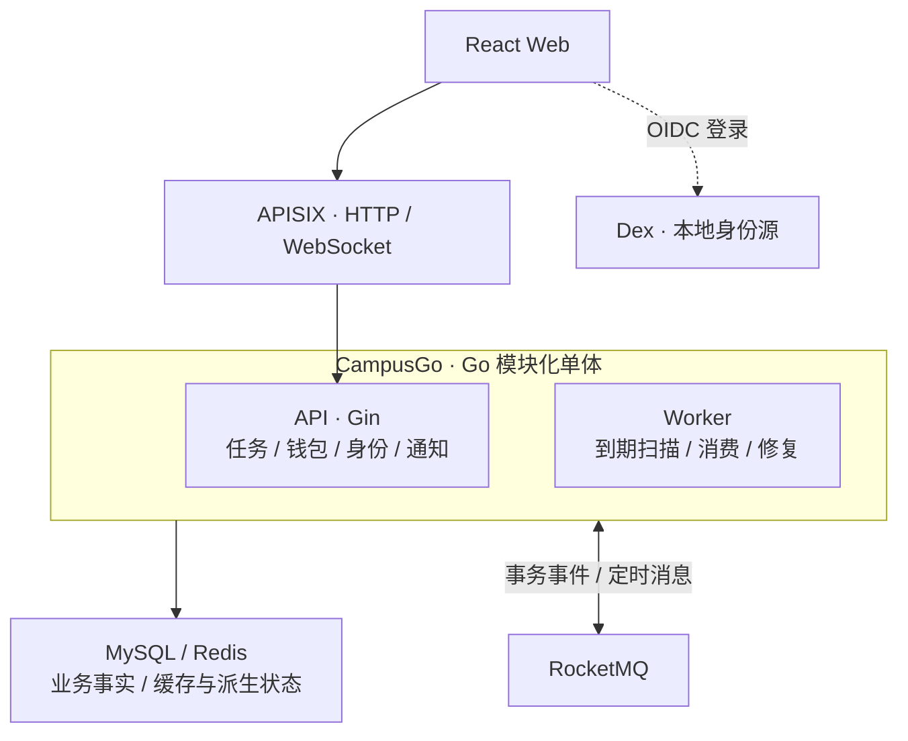

# CampusGo

**高并发校园跑腿抢单与可靠交易结算系统**

## Overview

CampusGo 面向校园跑腿的单名额任务场景，覆盖任务发布与赏金托管、并发抢单、限时确认、超时转派、履约、结算退款及对账。项目关注热点竞争下的业务正确性、提交结果不明时的恢复，以及负载上升时对核心写路径的保护。

后端采用 Go 1.27、Gin、MySQL 8.0、Redis 7.4、RocketMQ 5.3 和 APISIX，React 前端用于操作完整业务流程。 [Go 依赖](go.mod) · [本地服务版本](deploy/local/compose.yaml)

## Highlights

- **同轮唯一接单**。Redis 预占缩小竞争范围，MySQL 条件更新决定正式接单，异常请求可按原键查回结果。
- **超时任务可恢复**。定时消息与数据库到期扫描共用业务处理，消息延迟或重投时仍以当前任务轮次和截止时间裁决。
- **结算可核对**。任务、托管、复式流水和信用变更在本地事务内落地，资金事件可回查、重发和消费去重。
- **隔离热点读写**。详情命中跳过任务 SQL，单任务写槽限制热点占用，结果查询保留独立预算。
- **通知随时可补查**。站内通知持久化，WebSocket 跨 API 节点提示变化，前端在重连后重新查询。

## Architecture



API 处理用户请求与实时连接，并与 Dex 完成 OIDC 回调。Worker 消费资金和超时消息、扫描到期任务并推进补偿。两个进程共享领域规则及存储协议，各自运行连接池和并发预算。 [API 入口](cmd/api/main.go) · [Worker 入口](cmd/worker/main.go)

**业务主线**　发布并托管 → 抢单锁定 → 限时确认 → 取件与送达 → 手动或自动结算 → 对账与通知。确认超时可候补递补或回池，履约争议进入仲裁，按裁决结算或退款。 [状态机](internal/domain/errand/task.go)

## Engineering Design

### Concurrent Order Grabbing

抢单先在 MySQL 登记请求及租约，再通过 Redis Lua 按版本、轮次和令牌原子预占。MySQL 以状态、空余名额、版本和轮次为条件推进任务，唯一约束保护同轮接单记录。任务锁定、接单记录、请求结果和下一步超时消息同事务提交，正式接单以 SQL 记录为准。 [应用流程](internal/application/grab.go) · [预占 Lua](internal/adapter/mysql/lua/acquire_pending.lua) · [抢单事务](internal/adapter/mysql/grab.go)

预占之后进程退出，Worker 会扫描到期的持久请求并按令牌撤销旧占位。墓碑拦住已撤销请求的迟到预占。若 COMMIT 已生效但响应丢失，原键查询可读回成功结果，持久修复任务和巡检会按 MySQL 事实校准 Redis 投影。 [撤销 Lua](internal/adapter/mysql/lua/revoke_pending.lua) · [恢复与巡检](internal/adapter/mysql/grab_recovery.go)

### Reliable Messaging & Financial Consistency

发布与赏金托管共用本地事务。结算、退款和仲裁先发送 RocketMQ 事务半消息，确认后执行本地资金事务，原子更新任务、托管、余额、复式流水及相应信用事件。事务结果不明时依据持久请求和流水回查，已提交但未收到消费回执的事件可重发。重复消费在回执和通知写入时去重，实际转账在资金事务内完成。 [结算流程](internal/application/funds.go) · [过账](internal/adapter/mysql/wallet_posting.go) · [事务消息](internal/fundmq/client.go)

确认超时和送达后自动结算使用本地消息表与 RocketMQ 延迟消息，Worker 负责重发并独立扫描 MySQL 到期记录。定时消费与扫描都复核数据库时间、状态及轮次，候补资格在递补时重新检查。`reconcile` 在同一快照检查余额、守恒、托管及终态等 18 项不变量。 [超时用例](internal/application/timeouts.go) · [延迟消息](internal/timeoutmq/worker.go) · [快照对账](internal/wallet/reconcile.go)

### Hotspot Cache & Performance

同一任务的热点详情在 Redis 存四个副本键，随机读以分散键上的访问，四键共享任务 Hash Tag。命中时使用缓存中的任务字段判断可见性并跳过详情 SQL。短 TTL 空值挡住反复查询不存在的任务，逻辑过期的有效详情可在返回旧值时由有界队列刷新，重建锁约束回填。 [详情缓存](internal/adapter/mysql/detail_cache.go)

写路径提交后同步尝试失效，事务内登记持久失效任务，部分状态流转还会延迟再删。Lua 以版本水位阻止旧版本及空值迟到回填，Worker 巡检修复 Redis 漂移。抢单另按任务隔离写并发，单一热点最多占用本实例两个抢单写槽。 [失效 Lua](internal/adapter/mysql/lua/detail_cache.lua) · [并发准入](internal/adapter/mysql/grab_limits.go)

### Idempotency & Traffic Governance

发布、抢单与资金操作以 `Idempotency-Key` 和 SHA-256 命令指纹持久化请求。同身份同键同命令可恢复已有结果，同键换参会冲突。OIDC 提供登录身份，API 支持 Redis Session 和带刷新轮换、家族撤销的 JWT，并校验校区、角色和业务资格。接单准入还检查钱包与信用，确认时对同跑腿的在途额度串行裁决。 [发布存储](internal/adapter/mysql/publish.go) · [身份](internal/auth/) · [接单确认](internal/adapter/mysql/confirmation.go)

APISIX 用 Lua 令牌桶按路由和来源限速，并以原生并发限制保护入口。应用层掌握认证后的跑腿身份，分别限制每人和每人每任务的抢单速率，叠加实例内的单任务滑动窗口与全局写槽。结果查询使用独立桶和槽位，限流依赖故障时可走有界恢复预算，查询仍需通过认证。 [网关策略](deploy/local/apisix/campusgo-entry.lua) · [应用双桶](internal/adapter/mysql/lua/runner_rate_limit.lua)

### Durable Notification

资金消费回执与通知在同一 SQL 事务落库并去重。独立实时消费组通过 Redis 连接租约定位所在 API 节点，使用 Pub/Sub 向已认证 WebSocket 会话推送提示。页面重连及轮询会补查通知、未读数和最新业务状态。 [回执与通知](internal/adapter/mysql/fund_recovery.go) · [跨节点路由](internal/notify/realtime.go) · [前端通知](web/src/components/NotificationCenter.tsx)

## Benchmarks & Verification

下表来自单机 macOS／Docker Desktop 上的历史实测，使用仓库固定的中间件镜像。E09 经独立 APISIX 进入单 API，并提高了实验路由和 IP 速率预算。E11 计时段直连单 API。 [Compose 配置](deploy/local/compose.yaml)

| 场景 | 执行版本与负载 | 观测结果 |
| --- | --- | --- |
| 同一任务抢单（E09） | 2026-11-26 修复工作树，相关改动提交为 `61e9d93`。2,000 客户端同步放行，竞争一个预置名额 | 收齐 2,000 个 HTTP 响应，SQL 仅 1 个赢家、1 次锁定。落库 3 条最终为 1 成功、1 拒绝、1 过期，首轮唯一一条 `PROCESSING` 请求收敛（1/1） |
| 洪峰流量治理（同一轮 E09） | 按客户端总数与首次抢单请求落库数计算 | **1,997/2,000 未形成抢单请求记录（99.85%）**。全轮含 64 个应用限流 429 和 1,934 个 503，比例涵盖入口、应用准入及依赖失败 |
| 资金与业务一致性 | 2026-11-26 修复工作树的后端业务回归，常规库和隔离验证库各取快照 | 两库各 **18 项对账检查零违例**，覆盖资金守恒、托管与流水、结算收款对象和终态关联 |
| 热点详情（E11） | 2026-11-22 含 `33fa4de` 缓存改动的工作树。预热同一任务，按 600 请求/秒调度 30 秒 | **18,000/18,000 返回 200，详情缓存全命中、详情 SQL 为 0，P99 7.134 ms**。会话认证仍查用户 SQL，P99 从请求实际发起算起 |

E09 的 2,000 是并发客户端数，有效业务成功以 SQL 计。E11 的 600 QPS 对应已预热单任务读。两轮数据均来自各自实验配置，生产容量及持续混合负载仍待验证。 [E09 脚本](verification/e09-hot-grab.py) · [E11 脚本](verification/e06-e08.py) · [业务验收](verification/d8-business-backend.sh)

集成验证覆盖 MySQL COMMIT 回包丢失、API／Worker 在提交后退出、RocketMQ 重投与回执去重、详情缓存水位及失效恢复。认证与入口另外验证 JWT 轮换、跨节点实时路由及网关故障响应。 [故障脚本](verification/e06-e08.py) · [缓存与抢单测试](internal/adapter/mysql/grab_integration_test.go) · [网关验收](verification/d6.sh) · [通知验收](verification/d7.sh)

<details>
<summary>复跑实验场景</summary>

在独立的本地 Compose 环境中完成下方基础设施、迁移和种子初始化，再初始化隔离验证库。需要 Python 3、可用的实验端口（`18126`、`18129`、`18130`、`19126`、`19129`）和足够的文件描述符。容器需能访问脚本启动的宿主 API。验证库不应有交易数据、其他 Worker 或并行实验。

```sh
make build
./scripts/with-local-env.sh ./bin/migrate -database campusgo_verification up
./scripts/with-local-env.sh ./bin/seed -database campusgo_verification
./scripts/with-local-env.sh python3 verification/e09-hot-grab.py
CAMPUSGO_E11_RATE=600 ./scripts/with-local-env.sh python3 verification/e06-e08.py e11
```

串行执行，等待每个脚本输出 `PASS` 并完成清理。脚本会写入并清理本轮测试夹具。复跑使用所检出的代码及当前机器配置，延迟与拒绝分布会随环境变化。

</details>

## Quick Start

**环境**　Go ≥ 1.27.0、Node.js ≥ 24、npm、Make、Docker 和支持 `up --wait`、`wait` 的 Compose V2。以下使用本地 Session 模式、Dex 和 APISIX。 [配置模板](.env.example) · [Makefile](Makefile)

```sh
git clone https://github.com/yumestk/CampusGo.git
cd CampusGo
make env
```

`make env` 按模板创建 `.env` 并生成本地凭证，重复执行只补缺项。在隔离的本机开发环境中，将 `.env` 的 `CAMPUSGO_API_ADDR` 改为 `0.0.0.0:18080`，让容器内 APISIX 能访问宿主 API。同时设 `CAMPUSGO_REQUIRE_GATEWAY=true`，启用 API 的网关凭证校验。保留默认 OIDC 回调和前端地址。

```sh
make infra-up
make migrate
make seed
docker compose --env-file .env -f deploy/local/compose.yaml --profile gateway up -d apisix
```

`infra-up` 启动 MySQL、Redis、RocketMQ 和 Dex，并等待 RocketMQ 主题及消费组初始化。APISIX 通过单独的 `gateway` profile 启动。`migrate` 更新默认业务库，`seed` 初始化本地演示身份、OIDC 绑定和钱包，保留已有余额。

从仓库根目录执行 `make run-api`，另开终端执行 `make run-worker`。启动前端时再开一个终端，从根目录执行以下命令。

```sh
cd web
npm ci
npm run dev
```

- **前端**　打开 [127.0.0.1:15173](http://127.0.0.1:15173)，用「发单同学」发布任务，换「跑腿同学 A」抢单、确认和履约。Vite 默认把 `/api` 和 WebSocket 代理给 APISIX。 [代理配置](web/vite.config.ts)
- **网关**　`http://127.0.0.1:19080`。可用 `curl -fsS http://127.0.0.1:19080/api/auth/config` 检查业务 API 是否经网关可达。 [路由配置](deploy/local/apisix/apisix.yaml)
- **OIDC**　前端的「使用统一身份登录」会打开本地 Dex。可选择演示身份的 `publisher@campusgo.local`，密码取自己 `.env` 中生成的 `CAMPUSGO_LOCAL_IDP_PASSWORD`。默认回调经 `127.0.0.1:19080` 返回前端，浏览器地址应使用 `127.0.0.1`。 [Dex 配置](deploy/local/dex/config.yaml)

## Project Structure & Testing

```text
cmd/                 API、Worker、迁移、种子与对账工具
internal/
  domain/            任务状态、钱包过账、信用规则
  application/       抢单、发布、资金与恢复用例
  adapter/mysql/     SQL 事务及 Redis 投影、缓存与 Lua
  transport/httpapi/ HTTP 接口和权限边界
  auth/ notify/      身份、通知查询与跨节点推送
  fundmq/ timeoutmq/ 资金事务消息与定时消息
deploy/local/        Compose、APISIX 和 Dex 配置
migrations/          MySQL 迁移
verification/        多组件验收、故障注入与压测入口
scripts/             本地环境加载
web/                 React 前端与浏览器测试
```

[任务域](internal/domain/errand/) · [抢单 Lua](internal/adapter/mysql/lua/) · [资金事务](internal/adapter/mysql/funds.go) · [消息重发](internal/application/messages.go) · [修复任务](internal/application/repairs.go) · [持久化适配器](internal/adapter/mysql/) · [迁移](migrations/) · [验收脚本](verification/)

| 检查 | 命令与环境 |
| --- | --- |
| Go 测试 | `make test`。默认执行常规 Go 测试，依赖环境的集成用例由验收脚本显式启用 |
| 格式、静态检查与竞态 | `make check`。运行 `gofmt` 检查、`go vet`、全包 race 及 RocketMQ SDK 指标竞态回归 |
| 后端集成验收 | `make env build` 后执行 `./scripts/with-local-env.sh ./verification/d8-business-backend.sh`。需要 Docker、Compose 和 Python 3，脚本使用本地隔离库及测试夹具 |
| 业务与浏览器验收 | `make verify-d8-business`。额外需要 Node.js、可安装 Chromium 的 Playwright 环境和空闲服务端口。Session、JWT 各跑一轮正常业务链路 |
| 性能压测与指定故障 | 使用实验板块的独立脚本及测试环境 |

CI 的任务定义与环境准备见 [GitHub Actions 工作流](.github/workflows/ci.yml)。

## Limitations

- 钱包是模拟资金账本，演示身份由本地种子与 Dex 提供。当前范围不含真实支付、提现或校园生产身份源。
- 候补登记与 WebSocket 提示尽力提供。任务终态和通知补查以 MySQL 持久事实为准。
- 现有证据覆盖单机 Compose、有限跨 API 节点联调及定点故障注入。持续混合负载、跨机容灾、长时间积压和真实滚动部署仍缺完整验证。

## License

[MIT License](LICENSE)
